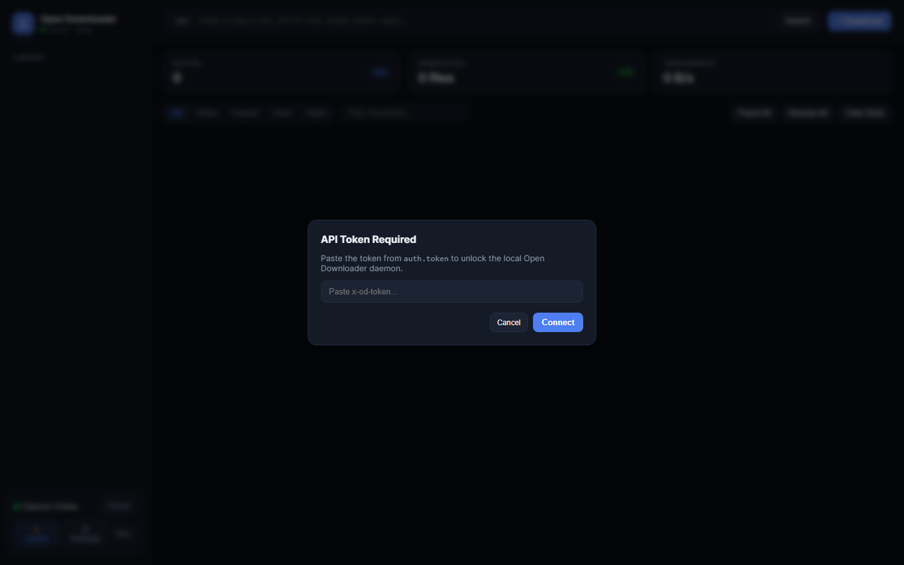
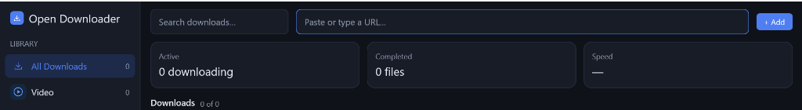

# Open Downloader

An IDM-style download manager written entirely in Rust — a segmented
download engine, a GPUI desktop UI, a CLI, and a browser extension that
hands downloads off to the app. GPLv2.

```
crates/
  od-core   # engine: two-phase Fetcher/Resource, TaskManager, retry/backoff,
            # ranged chunk-queue downloads, resume journals, HLS + DASH,
            # AES-128, rate limit, cross-platform autostart
  od-api    # Axum REST API v1, SSE live events, MCP JSON-RPC 2.0, /add
  od-cli    # `od` — headless downloader, `resolve`, `serve` daemon, `autostart`
  od-app    # GPUI desktop app with live progress + localhost /add endpoint
  od-nmh    # native messaging host for the browser extension
deploy/     # OS-native startup templates (Windows Task Scheduler, macOS LaunchAgent, Linux systemd/XDG)
docs/       # Local run & preview documentation (docs/LOCAL_PREVIEW.md)
extension/  # MV3 extension (Chrome/Edge + Firefox variant)
scripts/    # install.ps1, uninstall.ps1, install.sh, uninstall.sh, install-host.ps1, bump-version.ps1
```

> **Local Preview & Testing Guide:** See [docs/LOCAL_PREVIEW.md](docs/LOCAL_PREVIEW.md) for step-by-step instructions to preview the CLI, headless daemon (`REST + SSE + MCP`), GPUI app, browser extension, Ninja Detective, and cross-platform auto-startup.
>
> **Architecture & Product Docs:** [BRD](docs/BRD.md) · [PRD](docs/PRD.md) · [TSD](docs/TSD.md) · [SDD](docs/SDD.md)

## Preview

| Web Control Center (`od serve` · Obsidian Cobalt) | Native GPUI Desktop App (`od-app`) |
|---|---|
|  |  |

## Prerequisites

- Rust 1.85+ (edition 2024) — <https://rustup.rs>
- Windows 10/11 for the GUI + install scripts; `od-core`/`od-cli` are
  cross-platform

## Quick start

```powershell
cargo build            # od-core + od-cli only (fast)
cargo test             # full suite — local test servers, no network needed
.\target\debug\od.exe https://example.com/file.zip
.\target\debug\od.exe -o out.zip https://example.com/file.zip
```

Multiple URLs are scheduled two-at-a-time; `Ctrl-C` pauses — re-run the
same command and completed chunks resume from the `.odj` journal.

### The GUI — note the flag

`od-app` is **excluded from `default-members`** because gpui pulls ~400
dependency crates (10+ min first build). It never builds or tests unless
you ask for it:

```powershell
cargo run -p od-app              # first build is slow, then incremental
cargo test -p od-app             # gpui view tests (test-support feature)
```

While running it:

- binds `127.0.0.1:19799` (`POST /add`) — that port doubles as the
  single-instance lock; a second launch exits with a message
- writes a shared auth token to `%LOCALAPPDATA%\OpenDownloader\auth.token`
- saves downloads to `~\Downloads`, with per-item pause/resume buttons
- "Paste URL & Download" reads the clipboard (raw gpui has no text input
  yet — this is the intended input path for now)

## Browser capture (the IDM part)

The extension intercepts browser downloads via native messaging:
`od-nmh` forwards `{url, filename, cookie, referer}` to the running app's
`/add` endpoint (token-authenticated), or falls back to spawning `od.exe`
**from the same directory as od-nmh.exe** — keep the binaries together.

Dev setup:

```powershell
cargo build --release                                   # all three binaries
# chrome://extensions → Developer mode → Load unpacked → select extension/
# copy the extension ID from the card
.\scripts\install-host.ps1 -ExtensionId <id>            # Chrome + Edge
.\scripts\install-host.ps1 -ExtensionId <id> -Firefox   # also Firefox
```

Reload the extension, download anything in the browser — it lands in the
app's list. Without the host the extension calls `suggest()` and the
browser downloads normally.

The toolbar popup controls capture: an on/off switch, "all files" vs a
checked list of extensions (plus custom comma-separated types), a
minimum file size, and a per-site exclusion list ("+ this site" adds the
current tab). It also lists media the tab has requested — sniffed
`.mp4`/`.m3u8`/`.mpd`/audio URLs appear with a badge count and a "Get"
button that sends them (with referer + cookies) to the app. Settings
save instantly to `chrome.storage.local`.

`extension/test/extension.test.mjs` is a Node harness that stubs the
`chrome.*` APIs and exercises every capture path: `node
extension/test/extension.test.mjs`.

For Firefox, load `extension/manifest.firefox.json` via `about:debugging`.

## Full install

```powershell
.\scripts\install.ps1 -ExtensionId <id>
```

builds release binaries, copies them to `%LOCALAPPDATA%\OpenDownloader\bin`,
registers the native-messaging host, adds a Start Menu shortcut, and puts
`od` on the user PATH. `.\scripts\uninstall.ps1` removes all of it.

## What it downloads

- Any `http(s)` file — parallel `Range` requests with work-stealing chunks,
  resumable across restarts
- Files are **sorted into type folders** under the destination —
  `Video/`, `Audio/`, `Documents/`, `Images/`, `Compressed/`, `Programs/`
  — detected from extension → stream kind → Content-Type. Unrecognized
  types stay in the base folder; an explicit `od -o path` is never moved.
- **HLS** `.m3u8` — master→best-bandwidth variant, segments concatenated to
  `.ts` (or `.mp4` for fMP4), AES-128 `EXT-X-KEY` decrypted (incl. rotation)
- **DASH** `.mpd` — static `SegmentList`, `SegmentTemplate` (incl.
  `SegmentTimeline`), or `BaseURL` representations, output `.mp4`

Not supported (clear errors, not silent breakage): live streams, DRM
(SAMPLE-AES/Widevine/FairPlay), multi-track remuxing.

## Testing

```powershell
cargo test               # engine: unit + e2e (axum local servers, ranged,
                         # resume, cancel, headers, HLS, DASH, AES-128)
cargo test -p od-app     # GUI logic via gpui TestAppContext
```

## Dev notes

- Downloads write `dest.part` + `dest.odj`; streams use `dest.segments/`
  (both gitignored patterns)
- `/add` is loopback-only and token-gated — the token just proves the
  caller is a process running as this user
- Stale binaries bite twice already: `cargo check` doesn't emit `.exe` —
  after checking, `cargo build` before smoke-testing a binary

## Community, Security & Licensing

- **Contributing:** [CONTRIBUTING.md](CONTRIBUTING.md)
- **Code of Conduct:** [CODE_OF_CONDUCT.md](CODE_OF_CONDUCT.md)
- **Security Policy:** [SECURITY.md](SECURITY.md)
- **Licenses:** [LICENSE-MIT](LICENSE-MIT) · [LICENSE-APACHE](LICENSE-APACHE) · [LICENSE](LICENSE)
