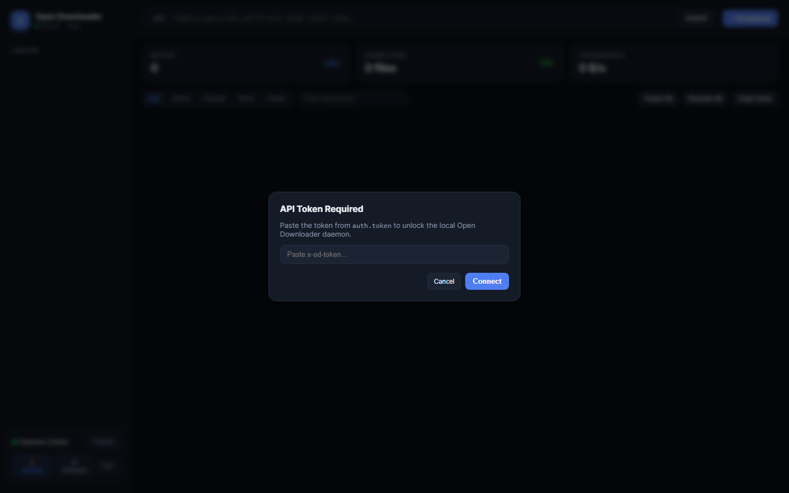
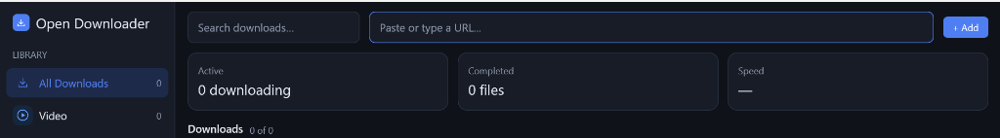
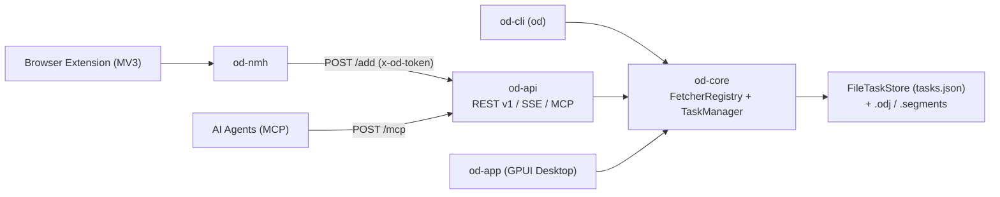

# Open Downloader — Local Run & Preview Guide (`v0.2.0`)

This guide walks through running, previewing, and verifying every component of **Open Downloader** locally — CLI, headless daemon (`REST + SSE + MCP`), GPUI desktop app, browser extension, Ninja Detective, and cross-platform auto-startup.

## Visual Preview

### Web Control Center (`http://127.0.0.1:19799/`)


### Native GPUI Desktop App (`od-app`)


---

## Architecture Overview



---

## 1. Prerequisites

- **Rust 1.85+** (edition 2024): <https://rustup.rs>
- **Node.js 18+** *(optional — only needed to run browser extension unit tests)*
- **OS:**
  - `od-core`, `od-api`, `od-cli`, `od-nmh`: **Windows, Linux, macOS**
  - `od-app` (GPUI desktop UI): **Windows 10/11** (excluded from default workspace members so CLI/daemon builds stay fast)

---

## 2. Fast Local Build & Test Verification

Build the core workspace (`od-core`, `od-api`, `od-cli`) and run the full automated test suite (uses local loopback test servers — **no internet required**):

```powershell
# Build core + API + CLI
cargo build

# Run all 43 unit & integration tests
cargo test

# Strict lint check
cargo clippy --all-targets -- -D warnings
```

Check the installed CLI version and help menu:

```powershell
.\target\debug\od.exe --version
.\target\debug\od.exe --help
```

*(On Linux/macOS, use `./target/debug/od` instead of `.\target\debug\od.exe`.)*

---

## 3. Preview Mode A — CLI Direct Download & Two-Phase Resolve

### Inspect a URL without downloading (`resolve`)
```powershell
.\target\debug\od.exe resolve https://example.com/archive.zip
```
Outputs the resolved `Resource` JSON (sanitized filename, total size, range support, detected category, and file entries).

### Download one or more URLs directly
```powershell
# Auto-detect filename & sort into category folder (Video/, Compressed/, Documents/, ...)
.\target\debug\od.exe https://example.com/archive.zip

# Explicit output path (never relocated into a category subfolder)
.\target\debug\od.exe -o .\my-file.zip https://example.com/archive.zip
```
Press `Ctrl+C` at any time to pause; re-run the same command to resume from the `.odj` journal or `.segments/` directory.

---

## 4. Preview Mode B — Headless Daemon (`REST API + SSE + MCP`)

Start the persistent local daemon (binds `127.0.0.1:19799` by default):

```powershell
# PowerShell (Windows)
.\target\debug\od.exe serve --addr 127.0.0.1:19799 --dir .\preview-downloads --concurrency 3
```

```bash
# Bash (Linux / macOS)
./target/debug/od serve --addr 127.0.0.1:19799 --dir ./preview-downloads --concurrency 3
```

### Test the Live Endpoints

Read the local auth token first:

```powershell
# PowerShell
$TOKEN = (Get-Content "$env:LOCALAPPDATA\OpenDownloader\auth.token").Trim()
```

```bash
# Linux / macOS
TOKEN="$(cat "${XDG_DATA_HOME:-$HOME/.local/share}/open-downloader/auth.token" 2>/dev/null || cat /tmp/OpenDownloader/auth.token)"
```

#### 1. Health Check (public)
```powershell
Invoke-RestMethod http://127.0.0.1:19799/api/v1/health
```
```bash
curl -s http://127.0.0.1:19799/api/v1/health
```

#### 2. Resolve a Resource (`POST /api/v1/resolve`)
```powershell
Invoke-RestMethod -Method Post http://127.0.0.1:19799/api/v1/resolve `
  -Headers @{ "x-od-token" = $TOKEN } `
  -ContentType "application/json" `
  -Body '{"url":"https://example.com/file.zip"}'
```

#### 3. Create, List, Pause, Resume, and Delete Tasks
```powershell
# Create a download task
$task = Invoke-RestMethod -Method Post http://127.0.0.1:19799/api/v1/tasks `
  -Headers @{ "x-od-token" = $TOKEN } `
  -ContentType "application/json" `
  -Body '{"url":"https://example.com/file.zip","auto_start":true}'

# List all tasks (with live progress, speed_bps, eta_secs)
Invoke-RestMethod http://127.0.0.1:19799/api/v1/tasks -Headers @{ "x-od-token" = $TOKEN }

# Pause / Resume / Delete
Invoke-RestMethod -Method Post "http://127.0.0.1:19799/api/v1/tasks/$($task.id)/pause"  -Headers @{ "x-od-token" = $TOKEN }
Invoke-RestMethod -Method Post "http://127.0.0.1:19799/api/v1/tasks/$($task.id)/resume" -Headers @{ "x-od-token" = $TOKEN }
Invoke-RestMethod -Method Delete "http://127.0.0.1:19799/api/v1/tasks/$($task.id)?delete_files=true" -Headers @{ "x-od-token" = $TOKEN }
```

#### 4. Watch Live Progress Stream (SSE)
```bash
curl -N -H "x-od-token: $TOKEN" http://127.0.0.1:19799/api/v1/events
```

#### 5. Test the AI Agent MCP Endpoint (`POST /mcp`)
```powershell
# List available MCP tools
Invoke-RestMethod -Method Post http://127.0.0.1:19799/mcp `
  -Headers @{ "x-od-token" = $TOKEN } `
  -ContentType "application/json" `
  -Body '{"jsonrpc":"2.0","id":1,"method":"tools/list"}'
```

---

## 5. Preview Mode C — GPUI Desktop App (Windows)

> **Note:** First build of `od-app` compiles ~400 GPUI dependency crates (~10 min once); incremental rebuilds are fast.

```powershell
cargo run -p od-app
cargo test -p od-app
```

---

## 6. Preview Mode D — Browser Extension (Chrome / Edge / Firefox)

1. Run the extension unit test harness (no browser required):
   ```powershell
   node extension/test/extension.test.mjs
   ```
2. Load unpacked in Chrome/Edge:
   - Open `chrome://extensions` → enable **Developer mode** → **Load unpacked** → select `extension/`.
   - Copy the generated **Extension ID**.
3. Register the native messaging host:
   ```powershell
   cargo build --release -p od-cli -p od-nmh
   .\scripts\install-host.ps1 -ExtensionId <YOUR_EXTENSION_ID>
   ```
4. Reload the extension and click any download link — it hands off directly to the running `od serve` daemon or `od-app`.

---

## 7. Preview Auto-Startup & Full Local Install

### Quick CLI Auto-Start Toggle (No Full Install Needed)
```powershell
.\target\debug\od.exe autostart status
.\target\debug\od.exe autostart enable
.\target\debug\od.exe autostart disable
```

### Full User-Level Installation
- **Windows (Headless Daemon — fast, skips GPUI build):**
  ```powershell
  .\scripts\install.ps1 -SkipGui -AutoStartMode Daemon
  ```
- **Windows (Full GUI + Browser Extension + Daemon Auto-Start):**
  ```powershell
  .\scripts\install.ps1 -ExtensionId <YOUR_EXTENSION_ID> -AutoStartMode Daemon
  ```
- **Linux / macOS:**
  ```bash
  ./scripts/install.sh
  # or without auto-start:
  ./scripts/install.sh --no-autostart
  ```

### Clean Uninstall
- **Windows:** `.\scripts\uninstall.ps1`
- **Linux / macOS:** `./scripts/uninstall.sh`

---

## 8. Troubleshooting

| Symptom | Fix |
|---|---|
| `401 Unauthorized` on `/api/v1/*` or `/mcp` | Pass header `x-od-token: <token>` or `Authorization: Bearer <token>` from `auth.token`. |
| Port `19799` already in use | Another `od serve` or `od-app` instance is running. Stop it or pass `--addr 127.0.0.1:19800`. |
| Changes not reflected when running `.exe` | `cargo check` does not emit binaries — run `cargo build` (or `cargo build --release`) before running the executable. |
| Browser extension falls back to browser download | Ensure `od-nmh` and `od` are in the same directory and `install-host.ps1` / `install.sh --extension-id` was run with the exact Extension ID. |
