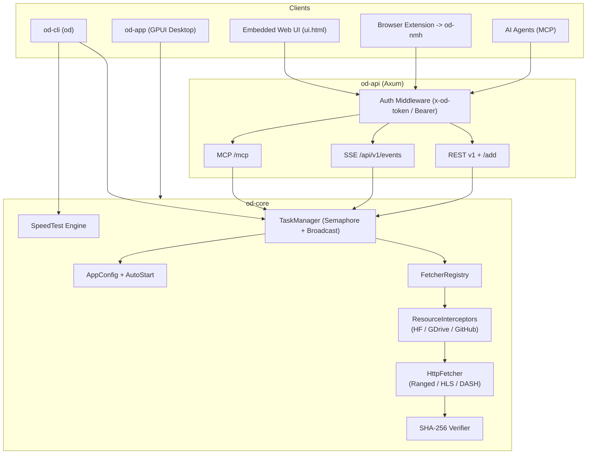
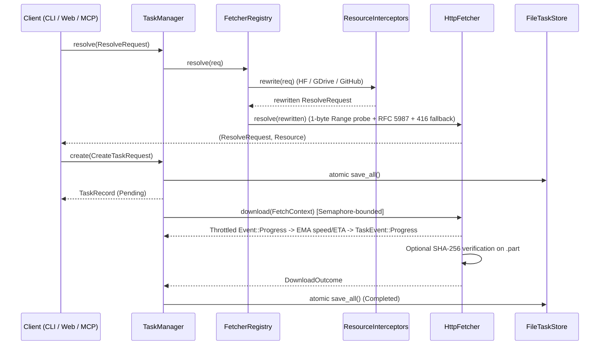
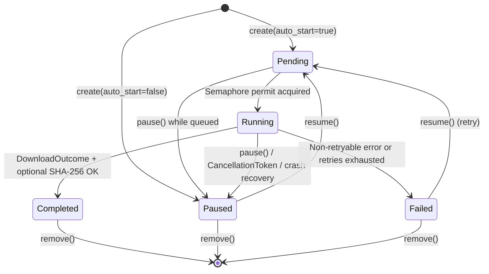

# Software Design Document (SDD) — Open Downloader

| Field | Value |
|---|---|
| **Version** | `v0.2.0` |
| **Scope** | Internal module design, concurrency model, state machines, algorithms, and UI architecture |

---

## 1. High-Level Component Architecture

---

## 2. Two-Phase `Resolve → Download` Sequence

---

## 3. Task Lifecycle State Machine

---

## 4. Core Engine Algorithms & Invariants

### A. Ranged Work-Stealing & Zero Lock-Across-Await Journaling (`engine.rs`)
1. **Chunk Sizing:** `chunk_size = max(size / (connections * chunks_per_connection), min_chunk_size)`. Each worker claims the next index atomically via `AtomicUsize::fetch_add(1, Ordering::Relaxed)`.
2. **Non-Blocking Preallocation:** `.part` creation + `set_len(size)` executes inside `tokio::task::spawn_blocking`.
3. **One Handle Per Worker:** Each worker opens a single `tokio::fs::File` handle and seeks per chunk rather than re-opening on every chunk.
4. **Debounced Lock-Free Disk Flush:** Under `Mutex<JournalState>`, a worker inserts the completed chunk index and serializes JSON to `Vec<u8>` only when `>= 400 ms` have elapsed since the last flush. The mutex is dropped **before** `save_journal_bytes()` writes `.odj.tmp` and renames to `.odj`. A guaranteed final flush runs after all workers exit (including on cancellation).
5. **Throttled Progress Emission:** `ProgressEmitter` uses an `AtomicU64` millisecond gate (`50 ms` interval) so high-throughput streams never flood UI/SSE channels.

### B. Cancellation-Aware Retry Policy (`retry.rs`)
- Retries transient transport errors (`timeout`, `connect`, `body`, `ConnectionReset`, `UnexpectedEof`) and HTTP `408`/`425`/`429`/`500`/`502`/`503`/`504`.
- Exponential backoff (`initial_delay * 2^attempt`, capped at `max_delay`) with deterministic ±12.5% jitter; sleeps inside `tokio::select!` with `cancel.cancelled()`.
- On partial chunk failure, rolls back `AtomicU64` progress bytes before retrying.

### C. Speed Test & Diagnostics (`speedtest.rs`)
1. **Ping & Jitter:** Executes `N` sequential `0`-byte probes, discards probe `0` (cold TCP/TLS handshake), reports median RTT and mean absolute deviation (jitter).
2. **Time-Bounded Parallel Download:** Spawns `download_streams` concurrent GETs capped by `phase_budget_ms` (4.5s), sampling throughput every 150 ms for the live UI sparkline.
3. **Upload & Tuning:** Optional bounded POST burst + heuristic mapping `(ping_ms, download_mbps) → (ConnectionQuality, recommended_connections)`.

### D. Streaming SHA-256 (`verify.rs`)
- Pure-Rust RFC 6234 / FIPS 180-4 implementation reading `.part` in 64 KiB async buffers — zero external crypto crate bloat, verified against NIST test vectors.

---

## 5. UI Design System (`od-app` GPUI & `od-api` Web Dashboard)

Both surfaces share the **Obsidian Cobalt (Dark)** and **Porcelain Slate (Light)** 4-tier token architecture:
- **Surfaces:** `canvas` → `sidebar` → `card` → `elevated`
- **Brand Lockup:** `34×34` locked-aspect (`flex_shrink_0`) geometric chevron+bar mark + two-line `Open Downloader` / `v0.2.0 · Core` header.
- **Telemetry Strip:** Compact 68px KPI cards + live 32-sample `canvas()` throughput sparkline.
- **Automated Contrast Guard:** `od-app`'s `palettes_meet_contrast` test enforces WCAG AA luminance contrast ratios on every color token pair in CI.
